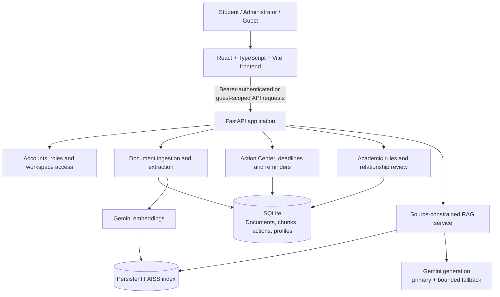
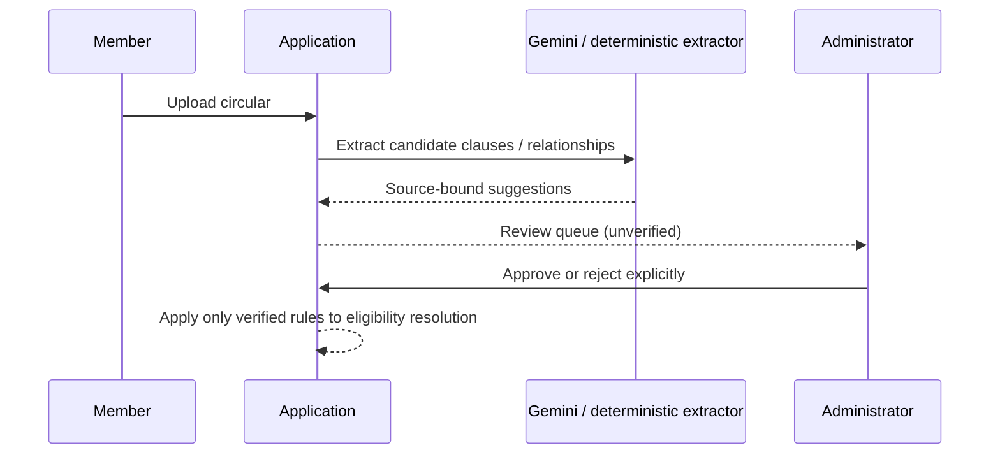

# CircularLens AI

### Evidence-grounded academic circular intelligence for university communities

[](https://www.python.org/)
[](https://fastapi.tiangolo.com/)
[](https://react.dev/)
[](https://www.typescriptlang.org/)
[](https://ai.google.dev/)
[](https://github.com/facebookresearch/faiss)

CircularLens AI is an MSc Data Science project for turning university circulars into searchable, source-aware information and student-owned academic actions. The application keeps the original circular, extracted passages, semantic retrieval results, suggested tasks, and administrative review steps connected—so users can trace an answer or action back to its evidence.

> **Safety principle:** AI-generated classifications, deadlines, academic clauses, and circular relationships are suggestions. They are not automatically treated as verified institutional facts.

## Highlights

| Area | What CircularLens AI provides |
|---|---|
| Circular ingestion | PDF, TXT, Markdown, and pasted-text circulars; selectable-text PDF extraction with page-aware chunks. |
| Retrieval | Gemini embeddings, persistent FAISS vectors, source passages, and workspace-scoped semantic search. |
| Generative AI | Gemini-assisted classification, short summaries, grounded Q&A, and editable application drafts. |
| Action Center | Database-backed actions, applications, payment tasks, deadlines, notifications, reminders, and completion history. |
| Academic intelligence | Review-gated rule suggestions, amendment relationships, private student profiles, and deterministic eligibility outcomes. |
| Privacy & access | JWT-style bearer sessions, workspace isolation, guest-session isolation, and administrator-only review operations. |

## Screenshots & existing product visuals

The repository currently includes the following product visual assets. No screenshots have been fabricated for this README.

<p align="center">
  
</p>

<p align="center"><em>Existing academic-AI landing-page visual.</em></p>

<p align="center">
  
</p>

## System architecture



## Gemini AI and RAG workflow

1. A member uploads a circular or pastes its text.
2. The backend extracts text, creates page-aware chunks where available, and persists the document metadata in SQLite.
3. Each chunk is embedded with `gemini-embedding-001`, normalized, and indexed in FAISS.
4. A question is embedded as a query and searched only against documents the current workspace is permitted to access.
5. Retrieved passages, document IDs, filenames, and page information are supplied to the Gemini generation service for a source-grounded response.
6. The UI receives the answer together with retrieved evidence; it does not receive the Gemini API key.

Generation uses a configurable primary model (`gemini-3.1-flash-lite` by default) and a configurable fallback (`gemini-3.5-flash-lite` by default). Transient 429/5xx errors have bounded retries and backoff; failures remain explicit rather than being replaced with fabricated output.

### FAISS semantic search

- Uses `faiss-cpu` with a persistent `IndexIDMap2(IndexFlatIP)` index.
- Stores normalized vectors and SQLite chunk IDs so FAISS results can be resolved back to their document evidence.
- Rebuilds the index through the application service, with compatibility metadata to prevent mixed embedding dimensions/providers.
- Guards ingestion failures: if semantic indexing cannot complete, the request returns an understandable error rather than claiming a circular was indexed.

## Personalized Action Center

The Action Center is backed by the application database—not static dashboard values. It brings together:

- active circulars and their source previews;
- pending applications and editable AI-assisted drafts;
- payment obligations and captured amounts;
- upcoming deadlines and `.ics` export;
- in-app reminders for pending or in-progress work;
- completed action history; and
- user-scoped notifications and preferences.

Informational notices are intentionally kept from becoming compulsory actions. Completing an action retains its history and cancels outstanding reminders for that action.

## Circular classification, deadlines, and payments

The intelligence routes support circular classification, summaries, potential deadlines, fees, required documents, and suggested actions. Extracted deadlines are not automatically official: confirmation of a deadline is an administrator-protected operation. The system also distinguishes payment actions from scholarship/application workflows, preventing a scholarship notice from being treated as a payment obligation.

## Administrator verification workflow



- All generated clauses and circular relationships begin as suggestions.
- Candidate source passages are checked against the stored circular text.
- Only an authorized administrator can review protected deadlines, rules, and relationships.
- The deterministic eligibility engine returns `ELIGIBLE`, `NOT ELIGIBLE`, or `NEEDS VERIFICATION` and excludes unverified suggestions from operational decisions.
- The public registration flow creates members only. First-administrator provisioning is a documented CLI operation, not a public web route.

## Technology stack

| Layer | Technologies present in this repository |
|---|---|
| Frontend | React 19, TypeScript, Vite, React Router, TanStack Query, Recharts, Lucide React, Tailwind tooling |
| Backend | Python, FastAPI, Pydantic, SQLAlchemy, Uvicorn |
| Data | SQLite and persistent local FAISS indexes |
| AI & retrieval | `google-genai`, Gemini embeddings/generation, FAISS, NumPy, Sentence Transformers fallback support |
| Document extraction | PyMuPDF (`fitz`) for selectable-text PDFs |
| Test tooling | Python `unittest`, FastAPI `TestClient`, TypeScript build, Oxlint |

## Project structure

```text
CircularLens AI/
├── backend/
│   ├── app/
│   │   ├── routes/          # Accounts, documents, RAG, intelligence, academic APIs
│   │   ├── models/          # SQLAlchemy document, action, profile, and review models
│   │   ├── services.py      # Extraction, Gemini, embeddings, FAISS, and RAG services
│   │   ├── reminders.py     # Persistent reminder scheduling logic
│   │   └── main.py          # FastAPI application and route registration
│   ├── tests/               # Isolated workflow integration tests
│   ├── tools/               # CLI-only administrator provisioning
│   ├── demo/                # Optional safe demo/import utilities
│   ├── evaluation/          # Reproducible intelligence evaluation scripts and reports
│   ├── requirements.txt
│   └── .env.example
├── frontend/
│   ├── src/                 # React application, public pages, guest workspace, styles
│   ├── public/              # Public static assets
│   ├── package.json
│   └── .env.example
├── evaluation/              # Full-system verification report
├── PROJECT_STATUS.md        # Historical, detailed verified-status record
└── README.md
```

## Installation

### Prerequisites

- Python **3.12+**
- Node.js **20+** and npm
- A Gemini API key authorized for the configured embedding and generation models

### 1. Clone and install dependencies

```powershell
git clone https://github.com/shettysudesh888-bot/CircularLens.git
cd CircularLens

py -3.12 -m venv backend\venv
.\backend\venv\Scripts\Activate.ps1
pip install -r backend\requirements.txt

cd frontend
npm ci
cd ..
```

### 2. Configure local environment variables

Use the committed templates as a reference. Never commit populated environment files.

```powershell
Copy-Item backend\.env.example backend\.env
Copy-Item frontend\.env.example frontend\.env
```

At minimum, configure these backend environment variables in your shell or preferred environment loader:

```dotenv
GEMINI_API_KEY=replace-with-your-gemini-api-key
CIRCULARLENS_AUTH_SECRET=replace-with-a-long-random-secret
```

Useful optional settings are documented in `backend/.env.example`, including generation model selection, bounded retry attempts, semantic-index location, and reminder-scheduler enablement. The frontend template defaults `VITE_API_URL` to `http://127.0.0.1:8000`.

## Run locally

Start the backend from the repository root:

```powershell
$env:GEMINI_API_KEY = '<your-key>'
$env:CIRCULARLENS_AUTH_SECRET = '<long-random-secret>'
.\backend\venv\Scripts\python.exe -m uvicorn backend.app.main:app --host 127.0.0.1 --port 8000
```

Start the frontend in a second terminal:

```powershell
cd frontend
npm run dev -- --host 127.0.0.1 --port 5173
```

Open [http://127.0.0.1:5173](http://127.0.0.1:5173). The Vite development server proxies `/api` requests to the FastAPI backend on port `8000`.

### Administrator provisioning

There is no public administrator-registration endpoint. For the first administrator, an authorized operator uses the local CLI with an operator-controlled bootstrap secret:

```powershell
$env:CIRCULARLENS_ADMIN_BOOTSTRAP_SECRET = '<operator-controlled-secret>'
.\backend\venv\Scripts\python.exe -m backend.tools.provision_admin --bootstrap --email admin@example.test --workspace 'Existing Workspace'
Remove-Item Env:CIRCULARLENS_ADMIN_BOOTSTRAP_SECRET
```

The provisioner uses the application password-hashing flow, refuses to elevate an existing member, and records an audit event.

<details>
<summary><strong>Run the verification commands</strong></summary>

```powershell
# From the repository root
.\backend\venv\Scripts\python.exe -m unittest backend.tests.test_isolated_workflow -v

# From frontend/
npm run lint
npm run build
```

</details>

## Verified test results

The following commands were run against this working tree on **24 November 2026**:

| Check | Result | Scope |
|---|---:|---|
| `python -m unittest backend.tests.test_isolated_workflow -v` | **PASS — 9/9** | Authentication, tenant isolation, guest isolation/expiry, document ingestion, real FAISS code path under an isolated test embedding service, actions, payment handling, reminders, preferences, private profiles, and explicit indexing-failure handling. |
| `npm run lint` | **PASS** | Frontend Oxlint. |
| `npm run build` | **PASS** | TypeScript project build and Vite production bundle. |

The backend test suite uses an isolated temporary SQLite database and FAISS directory. It deliberately uses test doubles for external Gemini requests, so these results do **not** claim a live Gemini provider quality measurement.

## Limitations and operational notes

- Gemini generation capacity and network availability are external dependencies; transient provider failures can still occur after bounded retries/fallback attempts.
- Image-only/scanned PDFs require OCR, which is not enabled by the current PyMuPDF-based selectable-text extraction path.
- In-app reminder state is persistent, but email/WhatsApp/push delivery needs a separately configured external delivery worker.
- SQLite and local FAISS persistence are appropriate for local development, research, and demonstration. A production multi-tenant deployment would need managed storage, secret management, observability, background workers, and stricter production CORS configuration.
- The repository contains evaluation utilities and historical reports, but no unmeasured aggregate Gemini-accuracy claim is made here.
- Runtime databases, vector indexes, uploads, populated `.env` files, and generated credentials are intentionally excluded from version control.

## Future improvements

- OCR pipeline for scanned circulars and multilingual university notices.
- Managed relational/vector storage and durable job orchestration.
- External email, push, and messaging notification delivery.
- Institutional invitations, SSO, and richer role management.
- Larger independently annotated circular datasets for transparent live-model evaluation.
- CI/CD, security scanning, rate-limit telemetry, and operational dashboards.

## Author

**Sudesh S Shetty**<br>
MSc Data Science, Dayananda Sagar University<br>
Academic Year: **2026–2027**

---

Built as an evidence-first Generative AI project for more reliable academic circular management.
